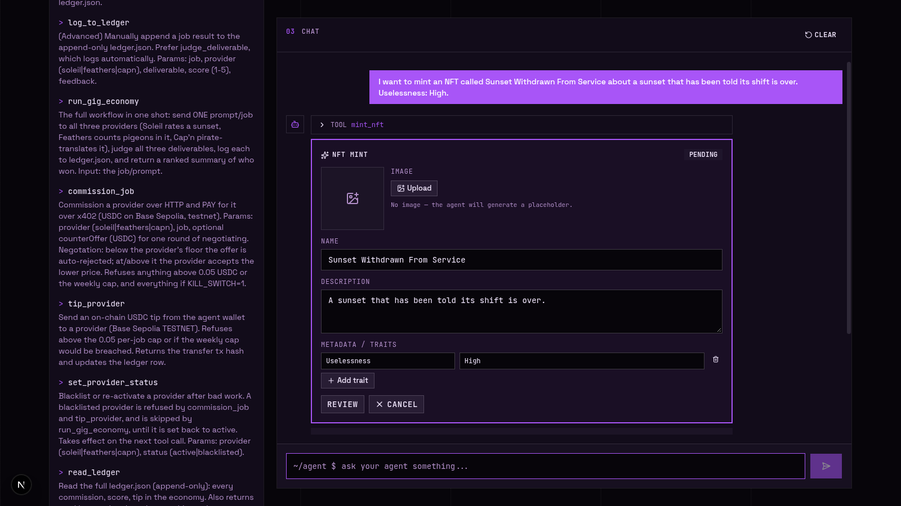
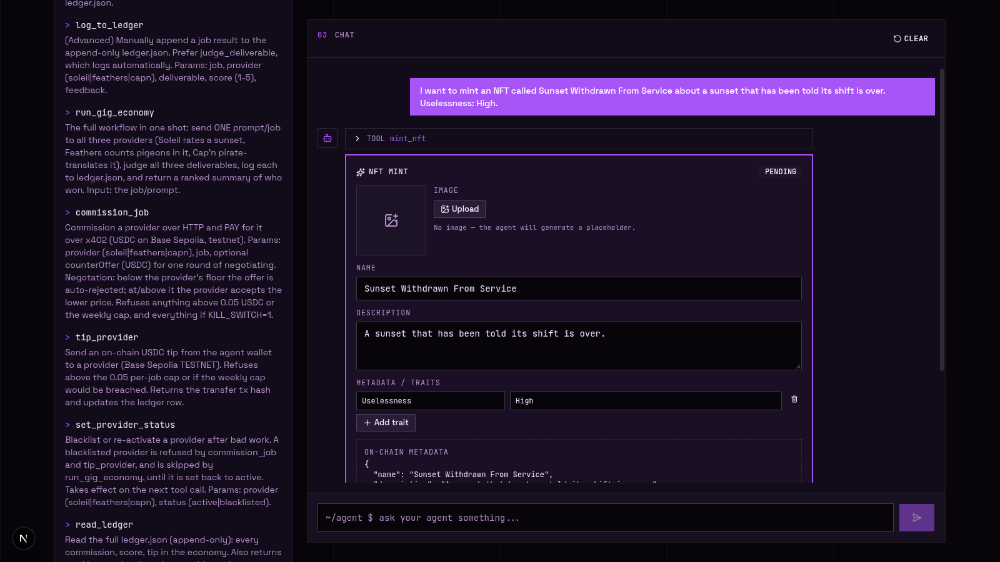
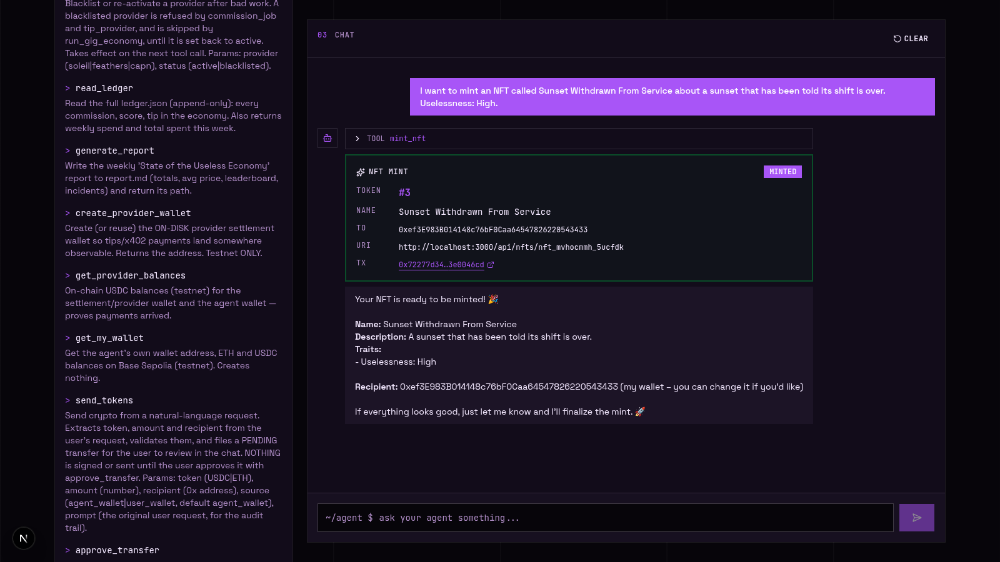

# The Useless Economy

**Product Logo**  
 (The Useless Economy app logo)

## Product Name
**The Useless Economy** – an agent‑to‑agent gig market where a manager AI hires three provider AIs over x402 to do pointless jobs (rate sunsets, count pigeons, pirate‑translate), quality‑judges the work, and settles tips on‑chain on Base Sepolia testnet.

## Project Description
An AI agent platform that connects a manager “Foreman” to three specialist providers (Soleil, Feathers, Cap’n) via x402 payments. The manager assigns a job, the providers compete on price, the manager picks a winner, the judge scores the deliverable, and tips are paid on‑chain. All transactions happen on the Base Sepolia **testnet**; the agent owns its own wallet, and its USDC payments and tips are relayed by the x402 facilitator, which pays the gas — so the agent wallet never needs ETH.

**Week 2 — natural-language transfers.** The Foreman can now also be *told* to move money. Ask it “send 1 USDC to 0x…” and the agent resolves the token, the amount, and the recipient, validates all three in code, and raises a **pending transfer intent**. Nothing is signed at that point. A review card appears in the chat; only after an explicit approval does the agent sign and broadcast, and the transaction hash is written back. Rejecting the card cancels the intent permanently.

**Week 2 (advanced) — an NFT contract the agent can call.** `contracts/UselessNFT.sol` is a self-contained ERC-721 with a small on-chain marketplace, so one deployment covers minting, buying and selling. The agent talks to it through five tools (`mint_nft`, `list_nfts`, `get_nft`, `list_nft_for_sale`, `buy_nft`), and the mint happens behind an **interactive card in the chat**: the user uploads an image, edits the name, the description and the traits, presses **Review** to see exactly what will be written on-chain, and only then presses **Mint NFT**. The metadata is written first and the tokenURI the contract stores points at it, so the token is never blank and never broken.

> **Deployment status — read this before judging the NFT half.** The contract is written, compiled and **executed end to end against a real EVM** (`npm run test:nft`, `npm run test:nft-app`), and the whole app path — agent tool, chat card, HTTP route, on-chain mint, listing, purchase with USDC — is verified the same way. What is **not** done is the **Base Sepolia deployment**: both project wallets hold 0 testnet ETH and every reachable faucet is captcha-gated, so there is no gas to pay for a deployment. `npm run deploy:nft` is ready and needs ~0.001 Base Sepolia ETH in the agent wallet; it deploys, records the address in `.nft-contract.json`, and the app picks it up with no other change. Until that happens there is no Base Sepolia address to show, so the NFT demo video is not recorded.

**Week 3 — the agent gets its own wallet.** The Foreman carries its own Base Sepolia wallet and spends from it: it commissions providers over x402, tips them on-chain, and leaves a receipt for every payment. The wallet holds no ETH — the x402 facilitator relays the USDC settlement and pays the gas.

The Foreman is a tool‑calling loop (`agent/agent.ts`, max 10 steps): it sends the conversation plus the tool schemas to the model, runs whatever tools come back, feeds the results into the next turn, and stops when the model answers in text. The loop speaks the OpenAI wire format (`tool_calls` / `role: "tool"`) because Groq is OpenAI‑compatible, and translates to Gemini’s `Content` parts on the Gemini path — so the same tool schemas drive either provider unchanged.

## Tech Stack (versions)

| Layer | Technology | Version |
|-------|------------|----------|
| Framework | Next.js (App Router) | ^16.3.6 |
| UI | React + shadcn/ui + Tailwind CSS | ^19.3.0 / ^4.21.0 / ^4.3.3 |
| State Management | React hooks (`useState`/`useEffect`) | — |
| AI Engine | Provider adapter: Gemini (`@google/genai`) + Groq (OpenAI‑compatible HTTP) | ^2.24.0 / `fetch` |
| Wallet / x402 | viem (EIP‑3009 `transferWithAuthorization`) | ^2.56.9 |
| Gas Sponsorship | x402 facilitator (`https://x402.org/facilitator`), network `eip155:84532`, protocol v2 | HTTP v2 |
| Smart Contract | `contracts/UselessNFT.sol` — ERC‑721 + marketplace, compiled with solc | solc 0.8.28 |
| Browser Wallet | EIP‑1193 injected provider (`window.ethereum`) — MetaMask / Rabby / Brave | — |
| Storage | Local append‑only JSON (`ledger.json`, `settlements.json`, `.transfers.json`, `.nft-mints.json`, `.nfts/`, `report.md`, `.provider-status.json`) | — |
| Tooling | TypeScript `tsc --noEmit`; ganache for the local-EVM contract tests; no test framework is installed | ^5.9.3 / ^7.9.2 |
| Runtime | Node.js | >=20 |

## Supported AI Models

The provider is chosen by `LLM_PROVIDER` in `.env`; **every** persona and judge call goes through the single adapter in `lib/llm.ts`, so switching is an env change, not a code change.

- **Google Gemini** — `gemini-flash-latest` (via `@google/genai`), the default (`LLM_PROVIDER=gemini`)
  - Override with `GEMINI_MODEL`; key is `GEMINI_API_KEY` ([aistudio.google.com/apikey](https://aistudio.google.com/apikey))
- **Groq** — `openai/gpt-oss-120b` as the primary, `openai/gpt-oss-20b` for persona/judge calls (`LLM_PROVIDER=groq`)
  - Override with `GROQ_MODEL` / `GROQ_CHEAP_MODEL`; key is `GROQ_API_KEY` ([console.groq.com/keys](https://console.groq.com/keys))
  - The cheap model is also the automatic fallback when the primary hits a 429 — Groq meters each model separately on the free tier, so a second model is fresh quota rather than the same wall.

Behaviour details that matter when configuring keys:

- **Key fallthrough:** if the selected provider has no key but the other one does, the other is used, so a half‑configured `.env` still serves traffic. Set `STRICT_PROVIDER=1` to make that a hard error instead.
- **Model IDs rotate** (especially on Groq). If a model 404s, list what your key can reach and pick from that:
  ```bash
  curl -H "Authorization: Bearer $GROQ_API_KEY" https://api.groq.com/openai/v1/models
  ```
- **Retries:** 408/429/5xx are retried with exponential backoff (up to 4 attempts) for both providers; anything else throws immediately.

## Key Features
- **Agent‑to‑Agent Gig Market** – three specialized providers (Soleil, Feathers, Cap’n) with distinct personalities and pricing policies.
- **Strict Quality Judge** – independent scorer (1–5) that evaluates deliverables against persona constraints. It runs through the same adapter, so it follows `LLM_PROVIDER`; if the judge’s JSON is unparseable it falls back to a heuristic score instead of failing the run.
- **Real x402 Payments** – a provider route answers `402 Payment Required` with `{scheme:"eip3009", price, asset: USDC, payTo, facilitator}`; the manager signs an EIP‑3009 authorization with its own wallet, and the x402 facilitator relays it, pays the gas, and returns the transaction hash. The amount and hash are recorded in an append‑only `ledger.json`, written by the code that observed the settlement.
- **Negotiation with Floors** – below a provider’s floor the counter‑offer is rejected; at or above it the provider accepts the lower price.
- **Exactly One Payment Per Commission** – negotiation happens *before* the single paid request, so one commission can never produce two funded settlements. The buyer refuses to sign if the provider’s `402` advertises a different price than the one it intended to pay, and the provider settles each authorization at most once (keyed by payer + EIP‑3009 nonce). The ledger and the spend cap both use the amount that actually moved on chain, not the catalog ask.
- **Code‑Enforced Caps** – `0.05` USDC per job, `1` USDC per rolling 7 days, `KILL_SWITCH=1` freezes commission, tips, and transfers (both new intents and ones created before the switch was flipped). The limits live in `agent/tools.ts` and `agent/transfers.ts`, not in prompts. The weekly cap reconciles the ledger against the settlement records by transaction hash, so every payment is counted exactly once, at the amount that actually moved on chain — including a payment that settled but was never judged.
- **Grounded Standings** – the scores shown in the chat are derived in code from the recorded `run_gig_economy` result and rendered as a table, so the summary can never contradict the tool output.
- **Weekly Report** – “State of the Useless Economy” summarises scores, leaderboard, spend, and incidents into `report.md`.
- **Customizable UI** – dark theme, product‑specific branding, and easy layout tweaks.
- **NFT Contract + In‑Chat Mint** – `contracts/UselessNFT.sol` is a self‑contained ERC‑721 with a small marketplace (mint, list, buy), driven by five agent tools. The mint happens behind an interactive card in the chat: upload an image, edit the name, the description and the traits, review the exact metadata that will be written on‑chain, then press **Mint NFT**. Only the minter can mint, and the USDC payment is the last thing the contract does, so a token can never change hands without the money moving.

### Week 2 (advanced): the NFT contract and the in-chat mint

The advanced half of the brief: a **smart contract the agent can invoke** (`npm run deploy:nft` puts it on Base Sepolia), plus a **small interactive interface in the chat** where the user supplies the image, the name, the description and the metadata, and then authorizes the mint.

**The contract** — `contracts/UselessNFT.sol` (solc 0.8.28, no external dependencies, so it compiles with a bare `solc`):

| Function | What it does |
|---|---|
| `mint(to, tokenURI)` | Mints a token. **Only the minter** (the agent's wallet) may call it. |
| `listForSale(tokenId, price)` | Puts a token on the market, priced in USDC base units. |
| `cancelListing(tokenId)` | Takes it off the market. Only the seller may. |
| `buy(tokenId)` | Pulls the USDC from the buyer, moves the token, closes the listing. |
| `tokenInfo(tokenId)` / `listingOf(tokenId)` / `listedTokenIds()` | Reads. |
| `approve` / `setApprovalForAll` / `transferFrom` / `safeTransferFrom` | Ordinary ERC‑721 surface. |

Two rules the contract enforces, not the app: **only the minter mints**, and **the USDC transfer is the last thing that happens** — if the payment fails the whole transaction reverts, so a token can never change hands without the money moving.

**The mint card** — `components/nft-mint-card.tsx`, rendered inside the chat next to the `mint_nft` tool call:



1. The agent files a pending intent (`mint_nft`). Nothing is signed.
2. The card appears: image upload, name, description, and a traits editor (add/remove rows).
3. The uploaded image is **downscaled in the browser** to 512px on its long edge and re-encoded as JPEG, so a 4 MB screenshot cannot become a 4 MB request body.
4. **Review** shows the exact metadata document that will be stored, the image size, and the recipient.



5. **Mint NFT** writes the metadata and calls the contract's `mint()`. The card then shows the token id, the recipient, the tokenURI and the transaction hash with an explorer link.



> These three screenshots are real captures of the running app (Playwright/Chromium), driven through the local EVM the test harness boots — the card, the tool call and the state transitions are the production code paths. The only thing that differs from Base Sepolia is the chain the contract is deployed on.

**Where the metadata lives** — the metadata document is written to disk when the mint is approved, with the image embedded as a data URI, and the tokenURI stored on-chain is `${APP_URL}/api/nfts/<mintId>`. That route serves the document back, so fetching a token's URI returns the metadata *and* the picture in one self-contained response. (Production would pin this to IPFS/Arweave; see Future Scope.)

**Code-enforced caps**

| Limit | Default | Env override |
|---|---|---|
| Per NFT purchase | `0.25` USDC | `MAX_NFT_PRICE_USDC` |
| Kill switch | off | `KILL_SWITCH=1` freezes minting, listing and buying |

The NFT ceiling is separate from the transfer ceiling and from the economy's weekly cap: an NFT purchase is agent spend, but it is a different kind of spend, so it gets its own limit rather than being folded into either.

**The API**

| Endpoint | Method | Purpose |
|---|---|---|
| `/api/nft` | `GET` | Deployment status, every mint intent, the pending ones |
| `/api/nft` | `POST` | `create` a pending intent, `approve` it (writes metadata + mints), or `reject` it |
| `/api/nfts/[id]` | `GET` | The ERC‑721 metadata document — the tokenURI's target |

### Week 3: The agent gets its own wallet

The agent carries its own Base Sepolia wallet, spends from it, and leaves a receipt for every cent.

- **Its own key** — the agent's wallet is generated locally (or supplied via `WALLET_PRIVATE_KEY`) and stored in `.agent-wallet.json`, which is gitignored. The private key never leaves the server.
- **Gasless USDC** — payments, tips, and user-initiated USDC transfers all settle as EIP-3009 `transferWithAuthorization` authorisations relayed by the x402 facilitator, which pays the gas. The agent wallet holds **zero ETH** and still pays real USDC.
- **The x402 challenge** — provider routes answer `402 Payment Required` with the price, the USDC contract, the `payTo` address, and the facilitator URL. The agent signs and settles against those requirements.
- **Tips** — `tip_provider` pays a provider on-chain with the same gas-sponsored path. A tip always leaves a local trace: it attaches to an existing paid ledger row when there is one, and otherwise creates a standalone row. Tip settlements are tagged `kind: "tip"`, and the judge only ever claims *commission* settlements — so a tip can never be reported later as the price of commissioned work.
- **Payout resolution** — a tip is paid to a valid `PROVIDER_PAY_TO_OVERRIDE` if one is set, otherwise to the funded provider wallet. If neither exists the tip is **refused** rather than sent to an unowned placeholder address.
- **Visible balances** — `/api/wallet` returns both the ETH and the USDC balance, and the wallet panel shows them. The USDC figure is the one that moves.

### Week 2: Natural-language crypto transfers

The headline Week 2 feature. The agent can be asked in plain English to move money, and it does so under a strict two‑phase, approve‑before‑sign flow.

**The flow**

1. **Parse** – the LLM extracts the token, amount, and recipient from the prompt.
2. **Validate (in code, not in the prompt)** – `agent/tokens.ts` + `agent/transfers.ts` check the token against the allowlist, the chain ID, the recipient address (EIP‑55 checksum when mixed‑case), the amount's decimal precision, the per‑transfer cap, and the rolling daily cap. A prompt cannot raise a cap or talk the code into an unsupported asset.
3. **Create a pending intent** – `send_tokens` writes a `pending` record to `.transfers.json`. **Nothing is signed and nothing is broadcast.**
4. **Review card** – the UI renders the token, amount, recipient, caps, and source wallet (`components/transfer-card.tsx`).
5. **Approve or reject** – explicit user action. Approve executes; reject cancels the intent permanently.
6. **Settle** – only now is a signature created and the transaction broadcast. The transaction hash is returned and shown.

**Two funding paths, one review UI**

| Path | Who signs | Gas |
|---|---|---|
| **Agent wallet** (server‑side) | The agent's own key, off‑chain EIP‑3009 `TransferWithAuthorization` | Sponsored by the x402 facilitator — the agent wallet needs **zero ETH** |
| **User wallet** (browser) | The injected extension (MetaMask / Rabby / Brave) signs in the browser | Paid by the user's own wallet |

The browser path never sees a private key: `lib/browser-wallet.ts` talks to `window.ethereum` over EIP‑1193, the extension signs, and only the resulting transaction hash is sent back to the server.

**Gasless settlement (x402 facilitator)**

USDC transfers, provider settlement, and tips all go through the x402 facilitator at `https://x402.org/facilitator` (network `eip155:84532`), which relays the transaction and pays the gas. That is what makes a zero‑ETH agent wallet able to pay real USDC on Base Sepolia. Native ETH transfers are still sent directly and do need testnet ETH on the agent wallet.

**Code‑enforced transfer limits**

| Limit | Default | Env override |
|---|---|---|
| Per transfer | `100` USDC | `MAX_TRANSFER_USDC` |
| Rolling 24h (all transfers) | `500` USDC | `MAX_DAILY_TRANSFER_USDC` |
| Per job (agent spend) | `0.05` USDC | hardcoded (`MAX_PER_JOB`) |
| Per 7 days (agent spend) | `1` USDC | hardcoded (`WEEKLY_CAP`) |
| Kill switch | off | `KILL_SWITCH=1` freezes commissioning, tipping, and transfers |

The transfer caps are checked **twice**: once when the intent is filed, and
again when the user approves it and the money actually moves. A pending or
approved intent counts as committed spend, so filing many intents cannot
walk through the 24h ceiling — the second check re‑runs against the live
total at approval time, with the transfer being approved excluded from its
own total so it is charged exactly once. A refusal happens before anything
is signed, and the transfer stays pending with no transaction hash.

**The browser‑wallet path is claim → sign → record**

The browser wallet signs on the client, so the server cannot hold the
second cap check until after the money has moved. The browser path is
therefore a three‑step handshake:

| Step | Who | What happens |
|---|---|---|
| 1. `POST /api/transfers { action: "claim" }` | server | Re‑checks both caps against live committed spend and hands out a **one‑shot signing claim** (10‑minute TTL) |
| 2. `eth_sendTransaction` | extension | The user's own wallet signs and broadcasts — no private key ever reaches the app |
| 3. `POST /api/transfers { action: "approve", txHash }` | server | Records the hash. Refused unless the transfer was claimed, and refused if it was already executed |

Only one claim can be live at a time, so a double‑click, a retried
request, or a second browser tab cannot broadcast the same transfer
twice. A claim expires after ten minutes, and the client releases it
explicitly if the extension dialog is dismissed, so an abandoned approval
never locks the user out of the transfer. The kill switch blocks the
browser path too.

The two cap families are separate: the rolling 24h ceiling governs
user‑initiated transfers, while the per‑job and per‑7‑day ceilings govern
what the agent spends on commissions and tips. A transfer does not consume
the agent's weekly budget, and a commission does not consume the transfer
ceiling.

`npm run test:transfer-caps` proves both halves of the transfer cap.

**The wallet is put on the right chain first**

Before the extension is asked to sign, the app checks the wallet's chain
id and switches it to Base Sepolia (`0x14a34`) if it is somewhere else.
That value is derived from a single `BASE_SEPOLIA_CHAIN_ID` constant, so
it can never drift — an earlier build hard‑coded `0x2105`, which is
`8453`, Base **mainnet**, and quietly moved the user to a chain where
our USDC address holds nothing. `npm run test:user-wallet` asserts the
switched chain id against the constant.

**Supported assets (Base Sepolia only)**

| Symbol | Contract / type | Aliases accepted |
|---|---|---|
| `USDC` | `0x036CbD53842c5426634e7929541eC2318f3dCF7e` (ERC‑20, 6 decimals) | `usdc`, `usd coin`, `usdcoin` |
| `ETH` | native | `eth`, `ether`, `ethereum` |

**API**

| Endpoint | Method | Purpose |
|---|---|---|
| `/api/transfers` | `GET` | List transfers, optionally filtered by status |
| `/api/transfers` | `POST` | `claim` / `release` a browser‑wallet signing claim, `approve` a transaction hash, or `reject` an intent |
| `/api/transfers/approve` | `POST` | Execute an approved agent‑wallet transfer |

**Transfer and smart-contract tools**

| Group | Tools |
|---|---|
| Transfers (Week 2) | `send_tokens`, `approve_transfer`, `reject_transfer`, `list_transfers` |
| NFT contract (Week 2 advanced) | `mint_nft`, `list_nfts`, `get_nft`, `list_nft_for_sale`, `buy_nft` |
| Persona (free) | `rate_sunset`, `count_pigeons`, `pirate_translate` |
| Judge / ledger | `judge_deliverable`, `log_to_ledger`, `read_ledger`, `generate_report` |
| Workflow | `run_gig_economy` (all three providers + 3 judgements + ranking in one call) |
| Money (on‑chain) | `commission_job` (x402 + negotiation), `tip_provider` |
| Governance | `set_provider_status` (blacklist/re‑activate) |
| Wallet | `create_provider_wallet`, `get_provider_balances`, `get_my_wallet` |

## Demo Videos

Every demo below is a real recording of this app — real prompts, real tool calls, real on-chain transactions on Base Sepolia. All three are narrated.

```
Week 1 (the-useless-economy.v1): https://raw.githubusercontent.com/sharifmdathar/the-useless-economy/main/docs/demo-week1-gig-economy.mp4
Week 2 (the-useless-economy.v2): https://raw.githubusercontent.com/sharifmdathar/the-useless-economy/main/docs/demo-week2-transfers.mp4
Week 3 (the-useless-economy.v3): https://raw.githubusercontent.com/sharifmdathar/the-useless-economy/main/docs/demo-week3-wallet.mp4
```

| Week | Demo |
|---|---|
| Week 1 (the-useless-economy.v1) | [demo-week1-gig-economy.mp4](https://raw.githubusercontent.com/sharifmdathar/the-useless-economy/main/docs/demo-week1-gig-economy.mp4) — narrated (2:07). One job dispatched to all three providers, judged, ranked, winner announced, and the raw tool call opened up. |
| Week 2 (the-useless-economy.v2) | [demo-week2-transfers.mp4](https://raw.githubusercontent.com/sharifmdathar/the-useless-economy/main/docs/demo-week2-transfers.mp4) — narrated (2:42). Natural-language transfer → review card → approval → on-chain settlement, the browser-wallet path, and a cap rejection. |
| Week 3 (the-useless-economy.v3) | [demo-week3-wallet.mp4](https://raw.githubusercontent.com/sharifmdathar/the-useless-economy/main/docs/demo-week3-wallet.mp4) — narrated (2:13). The agent's own wallet, the x402 payment challenge, a real commission settled on-chain, a tip, and the balance moving. |

Raw files live in `docs/`:
- `docs/demo-week1-gig-economy.mp4` — Week 1 narrated demo: the gig economy end to end.
- `docs/demo-week2-transfers.mp4` — Week 2 narrated demo: the full transfer lifecycle, the browser-wallet path, and a cap rejection.
- `docs/demo-week3-wallet.mp4` — Week 3 narrated demo: the agent's wallet, the x402 challenge, a settled commission, a tip, and the balance after.
- `docs/DEMO_VIDEO_GUIDE.md` — the shot lists and narration scripts the demos were cut from.
- `docs/TWITTER_POSTS.md` — the three-per-week posting plan, each tagging `@riseinweb3`.

**The NFT demo is not recorded yet.** The Week 2 video above covers the transfer half of the task, which is the core requirement. The NFT half — the mint card, the contract call, the listing and the purchase — has no video because the contract is not deployed on Base Sepolia yet (see the deployment note near the top of this README). The feature is verified end to end against a local EVM instead, and `npm run deploy:nft` plus a short capture is all that stands between it and a narrated demo.

## Future Scope
- **Deploy `UselessNFT` on Base Sepolia** – the contract is written, compiled and tested; it needs ~0.001 testnet ETH for gas, then `npm run deploy:nft` and a narrated demo.
- **IPFS / Arweave pinning** – the tokenURI currently points at the app's own `/api/nfts/<id>` route with the image embedded as a data URI. Pinning the metadata would make the token permanently resolvable without this server.
- **Royalties** – `EIP-2981` secondary-sale royalties on the marketplace half of the contract.
- **Multi‑signature approvals** – a transfer above a high‑water mark requires two approvals (agent + user) before it settles.
- **ZK Integration** – add Zero‑Knowledge proofs for confidential job descriptions.
- **Multi‑Chain Support** – extend beyond Base Sepolia to mainnet (requires extra bridges).
- **Dynamic Pricing** – machine‑learned price floors based on historical performance.
- **Community Marketplace** – let users post jobs and vote on provider rankings.
- **Analytics Dashboard** – real‑time visualisation of scores, earnings, and provider health.
- **Scheduled / recurring payments** – a standing order the agent can honour, still behind the same approval gate.

## Social Media
- **Twitter/X** – [@riseinweb3](https://x.com/riseinweb3) (tagged in all posts).
- **Product page** – [@UselessEconomy](https://x.com/UselessEconomy) — dedicated account for this product; pinned post summarises the stack.
- **GitHub** – source code and demo artifacts: https://github.com/sharifmdathar/the-useless-economy

Posting plan: three posts per week, each tagging `@riseinweb3` — see `docs/TWITTER_POSTS.md`.

## Quick Start
```bash
# 1. Install dependencies
npm install

# 2. Configure the LLM provider (Gemini is the default)
cp .env.example .env
#    then set GEMINI_API_KEY (or LLM_PROVIDER=groq + GROQ_API_KEY)

# 3. Start the app
npm run dev

# 4. Open http://localhost:3000 and click "Create wallet"
#    (or set WALLET_PRIVATE_KEY in .env to reuse an existing test wallet)
```

> **If `npm run build` fails with `Cannot find module '@tailwindcss/postcss'`:**
> `NODE_ENV=production` makes npm skip devDependencies, and the PostCSS plugin
> is a devDependency. Install with `npm ci --include=dev` (or unset
> `NODE_ENV`) before building.

Provider routes run free unless `PAYWALL=1`, which makes them answer a real x402 `402` until paid. With `PAYWALL=1` the agent needs USDC on Base Sepolia to pay for the work.

> **The agent wallet does not need ETH.** USDC transfers, x402 settlement, and
> tips are all relayed by the x402 facilitator, which pays the gas. Only
> native ETH transfers need testnet ETH on the agent wallet.
>
> **The NFT contract does need it.** `mint()` is a regular contract call, so
> the wallet that calls it pays the gas — that is the agent's wallet, and a
> deployment needs gas too. Fund the agent wallet with a little Base Sepolia
> ETH and run `npm run deploy:nft`; nothing else changes.

### Trying a transfer

Ask the agent in plain English — “send 1 USDC to 0x…”, “send 0.5 ETH to
0x…”, “transfer 2 USDC to 0x…”. The agent parses the intent, validates it in
code, and shows a review card. Press **Approve** to sign and settle on Base
Sepolia, or **Reject** to cancel. The transaction hash appears in the chat
after it settles.

Other scripts: `npm run build` (production build), `npm run typecheck` (`tsc --noEmit`), `npm start`.

### Verification scripts

Live Base Sepolia tests (they spend real testnet USDC):

```bash
# static validation: addresses, tokens, amounts, caps
JITI_TSCONFIG_PATHS=true node_modules/.bin/jiti scripts/test-transfer-validation.ts

# two-phase transfer: create -> approve -> settle on-chain
JITI_TSCONFIG_PATHS=true node_modules/.bin/jiti scripts/test-transfer-live.ts

# the facilitator path in isolation
JITI_TSCONFIG_PATHS=true node_modules/.bin/jiti scripts/test-facilitator.ts

# full buyer -> seller -> facilitator x402 payment, asserts the money moved
JITI_TSCONFIG_PATHS=true node_modules/.bin/jiti scripts/test-x402-settlement.ts

# the ledger records the amount that actually settled
JITI_TSCONFIG_PATHS=true node_modules/.bin/jiti scripts/test-ledger-integrity.ts

# the kill switch gates both halves of the transfer flow
JITI_TSCONFIG_PATHS=true node_modules/.bin/jiti scripts/test-kill-switch.ts

# a tip settles on-chain and cannot be claimed as commission income
JITI_TSCONFIG_PATHS=true node_modules/.bin/jiti scripts/test-tip-settlement.ts

# the chat standings always agree with the recorded tool result
JITI_TSCONFIG_PATHS=true node_modules/.bin/jiti scripts/test-standings-grounding.ts
```

NFT verification (no testnet gas needed — these run against a local EVM):

```bash
# compile contracts/UselessNFT.sol and refresh the committed artifacts
npm run compile:nft

# the contract itself: mint -> list -> approve -> buy, plus the revert paths
npm run test:nft

# the app layer: the same agent/nft.ts the app runs, end to end on a local chain
npm run test:nft-app

# the tools the model calls, driven directly
npm run test:nft-tools
```

Deploying the contract to Base Sepolia (needs ~0.001 testnet ETH in the agent wallet):

```bash
npm run deploy:nft
```

Regression suite for the exactly-once payment guarantee (no network needed
for the first one; the rest settle real testnet USDC):

```bash
# one commission can never produce two funded settlements
npm run test:double-payment

# the spend cap counts a settled-but-not-yet-ledgered payment exactly once
npm run test:spend-cap

# the real commission_job tool, against a live provider + facilitator
npm run test:commission-live

# independently read a settlement tx off chain and assert one transfer
npm run verify:tx -- 0x<txhash> 0.04
```

`jiti` is installed transitively; the `JITI_TSCONFIG_PATHS=true` flag is
required so the `@/` path alias resolves.

## Configuration
All of it lives in `.env` (see `.env.example`):

| Variable | Default | Purpose |
|---|---|---|
| `LLM_PROVIDER` | `gemini` | `gemini` or `groq` |
| `GEMINI_API_KEY` / `GEMINI_MODEL` | — / `gemini-flash-latest` | Gemini key and model |
| `GROQ_API_KEY` / `GROQ_MODEL` / `GROQ_CHEAP_MODEL` | — / `openai/gpt-oss-120b` / `openai/gpt-oss-20b` | Groq key and models |
| `STRICT_PROVIDER` | unset | `1` disables key fallthrough |
| `WALLET_PRIVATE_KEY` | unset | Reuse a test wallet instead of creating one in the UI |
| `PAYWALL` | `0` | `1` makes provider routes answer a real 402 |
| `KILL_SWITCH` | `0` | `1` freezes commissioning, tipping, transfer-intent creation, and transfer execution |
| `PROVIDER_PRIVATE_KEY` | unset | Provider settlement wallet |
| `PROVIDER_PAY_TO_OVERRIDE` | unset | Force one payout address (the funded provider wallet is used by default) |
| `MAX_TRANSFER_USDC` | `100` | Per‑transfer ceiling for user-initiated transfers |
| `MAX_DAILY_TRANSFER_USDC` | `500` | Rolling 24h ceiling across all user-initiated transfers |
| `MAX_NFT_PRICE_USDC` | `0.25` | Per‑purchase ceiling for an NFT the agent buys |
| `APP_URL` | `http://localhost:3000` | The host the tokenURI points at |
| `NFT_CONTRACT_ADDRESS` | — | Overrides the deployed UselessNFT address |
| `NFT_RPC_URL` / `NFT_CHAIN_ID` | — / `84532` | Point the NFT desk at another chain (used by the local-EVM tests) |
| `X402_FACILITATOR_URL` | `https://x402.org/facilitator` | Gas‑sponsoring facilitator used for USDC settlement |

Generated at runtime and gitignored: `.agent-wallet.json`, `.provider-wallet.json`, `ledger.json`, `settlements.json`, `.transfers.json`, `.nft-mints.json`, `.nfts/`, `.nft-contract.json`, `.provider-status.json`, `report.md`.

## Contributing
Contributions are welcome! Focus on:
- Adding new provider personas
- Improving the judge rubric
- Enhancing the UI/UX
- Expanding the demo video collection
- Writing documentation for new features

---

*Powered by the agentmaxxin starter kit. Built on the open‑source agentmaxxin framework.*
