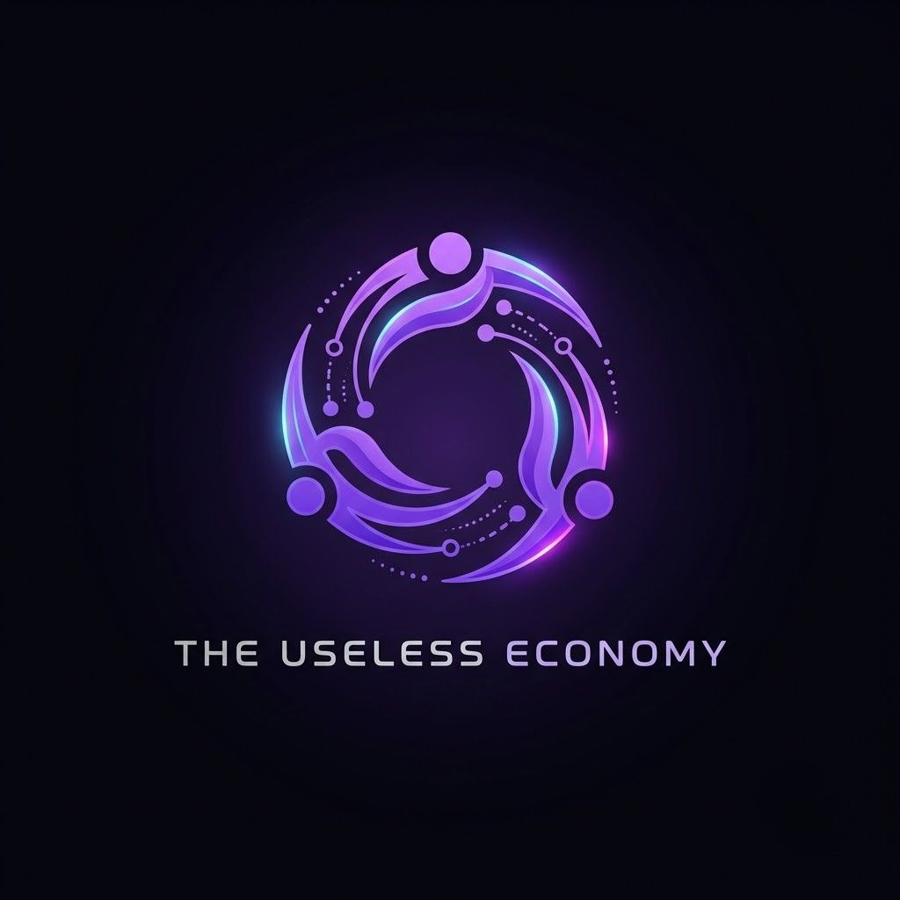

# The Useless Economy

**Product Logo**  
 (The Useless Economy app logo)

## Product Name
**The Useless Economy** – an agent‑to‑agent gig market where a manager AI hires three provider AIs over x402 to do pointless jobs (rate sunsets, count pigeons, pirate‑translate), quality‑judges the work, and settles tips on‑chain on Base Sepolia testnet.

## Project Description
An AI agent platform that connects a manager “Foreman” to three specialist providers (Soleil, Feathers, Cap’n) via x402 payments. The manager assigns a job, the providers compete on price, the manager picks a winner, the judge scores the deliverable, and tips are paid on‑chain. All transactions happen on the Base Sepolia **testnet**; the agent owns its own wallet for gas and tips.

**Week 2 — natural-language transfers.** The Foreman can now also be *told* to move money. Ask it “send 1 USDC to 0x…” and the agent resolves the token, the amount, and the recipient, validates all three in code, and raises a **pending transfer intent**. Nothing is signed at that point. A review card appears in the chat; only after an explicit approval does the agent sign and broadcast, and the transaction hash is written back. Rejecting the card cancels the intent permanently.

The Foreman is a tool‑calling loop (`agent/agent.ts`, max 10 steps): it sends the conversation plus the tool schemas to the model, runs whatever tools come back, feeds the results into the next turn, and stops when the model answers in text. The loop speaks the OpenAI wire format (`tool_calls` / `role: "tool"`) because Groq is OpenAI‑compatible, and translates to Gemini’s `Content` parts on the Gemini path — so the same tool schemas drive either provider unchanged.

## Tech Stack (versions)

| Layer | Technology | Version |
|-------|------------|----------|
| Framework | Next.js (App Router) | ^16.3.6 |
| UI | React + shadcn/ui + Tailwind CSS | ^19.3.0 / ^4.21.0 / ^4.3.3 |
| State Management | React hooks (`useState`/`useEffect`) | — |
| AI Engine | Provider adapter: Gemini (`@google/genai`) + Groq (OpenAI‑compatible HTTP) | ^2.24.0 / `fetch` |
| Wallet / x402 | viem (EIP‑3009 `transferWithAuthorization`) | ^2.56.9 |
| Gas Sponsorship | x402 facilitator (`https://x402.org/facilitator`), network `eip155:84532` | HTTP v2 |
| Browser Wallet | EIP‑1193 injected provider (`window.ethereum`) — MetaMask / Rabby / Brave | — |
| Database | Local append‑only JSON (`ledger.json`, `settlements.json`, `.transfers.json`, `report.md`, `.provider-status.json`) | — |
| Tooling | TypeScript `tsc --noEmit`; no test framework is installed | ^5.9.3 |
| Runtime | Node.js | >=20 |

## Supported AI Models

The provider is chosen by `LLM_PROVIDER` in `.env`; **every** persona and judge call goes through the single adapter in `lib/llm.ts`, so switching is an env change, not a code change.

- **Google Gemini** — `gemini-flash-latest` (via `@google/genai`), the default (`LLM_PROVIDER=gemini`)
  - Override with `GEMINI_MODEL`; key is `GEMINI_API_KEY` ([aistudio.google.com/apikey](https://aistudio.google.com/apikey))
- **Groq** — `openai/gpt-oss-120b` as the primary, `openai/gpt-oss-20b` for persona/judge calls (`LLM_PROVIDER=groq`)
  - Override with `GROQ_MODEL` / `GROQ_CHEAP_MODEL`; key is `GROQ_API_KEY` ([console.groq.com/keys](https://console.groq.com/keys))
  - The cheap model is also the automatic fallback when the primary hits a 429 — Groq meters each model separately on the free tier, so a second model is fresh quota rather than the same wall.

Behaviour details that matter when configuring keys:

- **Key fallthrough:** if the selected provider has no key but the other one does, the other is used, so a half‑configured `.env` still serves traffic. Set `STRICT_PROVIDER=1` to make that a hard error instead.
- **Model IDs rotate** (especially on Groq). If a model 404s, list what your key can reach and pick from that:
  ```bash
  curl -H "Authorization: Bearer $GROQ_API_KEY" https://api.groq.com/openai/v1/models
  ```
- **Retries:** 408/429/5xx are retried with exponential backoff (up to 4 attempts) for both providers; anything else throws immediately.

## Key Features
- **Agent‑to‑Agent Gig Market** – three specialized providers (Soleil, Feathers, Cap’n) with distinct personalities and pricing policies.
- **Strict Quality Judge** – independent scorer (1–5) that evaluates deliverables against persona constraints. It runs through the same adapter, so it follows `LLM_PROVIDER`; if the judge’s JSON is unparseable it falls back to a heuristic score instead of failing the run.
- **Real x402 Payments** – a provider route answers `402 Payment Required` with `{scheme:"eip3009", price, asset: USDC, payTo, facilitator}`; the manager signs an EIP‑3009 authorization with its own wallet, retries with `X‑PAYMENT`, and the provider verifies the signature before settling on‑chain. Settlements are recorded in an append‑only `ledger.json`.
- **Negotiation with Floors** – below a provider’s floor the counter‑offer is rejected; at or above it the provider accepts the lower price.
- **Code‑Enforced Caps** – `0.05` USDC per job, `1` USDC per rolling 7 days, `KILL_SWITCH=1` freezes commission, tips, and transfers (both new intents and ones created before the switch was flipped). The limits live in `agent/tools.ts` and `agent/transfers.ts`, not in prompts.
- **Weekly Report** – “State of the Useless Economy” summarises scores, leaderboard, spend, and incidents into `report.md`.
- **Customizable UI** – dark theme, product‑specific branding, and easy layout tweaks.

### Week 2: Natural-language crypto transfers

The headline Week 2 feature. The agent can be asked in plain English to move money, and it does so under a strict two‑phase, approve‑before‑sign flow.

**The flow**

1. **Parse** – the LLM extracts the token, amount, and recipient from the prompt.
2. **Validate (in code, not in the prompt)** – `agent/tokens.ts` + `agent/transfers.ts` check the token against the allowlist, the chain ID, the recipient address (EIP‑55 checksum when mixed‑case), the amount's decimal precision, the per‑transfer cap, and the rolling daily cap. A prompt cannot raise a cap or talk the code into an unsupported asset.
3. **Create a pending intent** – `send_tokens` writes a `pending` record to `.transfers.json`. **Nothing is signed and nothing is broadcast.**
4. **Review card** – the UI renders the token, amount, recipient, caps, and source wallet (`components/transfer-card.tsx`).
5. **Approve or reject** – explicit user action. Approve executes; reject cancels the intent permanently.
6. **Settle** – only now is a signature created and the transaction broadcast. The transaction hash is returned and shown.

**Two funding paths, one review UI**

| Path | Who signs | Gas |
|---|---|---|
| **Agent wallet** (server‑side) | The agent's own key, off‑chain EIP‑3009 `TransferWithAuthorization` | Sponsored by the x402 facilitator — the agent wallet needs **zero ETH** |
| **User wallet** (browser) | The injected extension (MetaMask / Rabby / Brave) signs in the browser | Paid by the user's own wallet |

The browser path never sees a private key: `lib/browser-wallet.ts` talks to `window.ethereum` over EIP‑1193, the extension signs, and only the resulting transaction hash is sent back to the server.

**Gasless settlement (x402 facilitator)**

USDC transfers, provider settlement, and tips all go through the x402 facilitator at `https://x402.org/facilitator` (network `eip155:84532`), which relays the transaction and pays the gas. That is what makes a zero‑ETH agent wallet able to pay real USDC on Base Sepolia. Native ETH transfers are still sent directly and do need testnet ETH on the agent wallet.

**Code‑enforced transfer limits**

| Limit | Default | Env override |
|---|---|---|
| Per transfer | `100` USDC | `MAX_TRANSFER_USDC` |
| Rolling 24h (all transfers) | `500` USDC | `MAX_DAILY_TRANSFER_USDC` |
| Per job (agent spend) | `0.05` USDC | hardcoded (`MAX_PER_JOB`) |
| Per 7 days (agent spend) | `1` USDC | hardcoded (`WEEKLY_CAP`) |
| Kill switch | off | `KILL_SWITCH=1` freezes commissioning, tipping, and transfers |

**Supported assets (Base Sepolia only)**

| Symbol | Contract / type | Aliases accepted |
|---|---|---|
| `USDC` | `0x036CbD53842c5426634e7929541eC2318f3dCF7e` (ERC‑20, 6 decimals) | `usdc`, `usd coin`, `usdcoin` |
| `ETH` | native | `eth`, `ether`, `ethereum` |

**API**

| Endpoint | Method | Purpose |
|---|---|---|
| `/api/transfers` | `GET` | List transfers, optionally filtered by status |
| `/api/transfers` | `POST` | Record a browser‑wallet transaction hash, or reject an intent |
| `/api/transfers/approve` | `POST` | Execute an approved agent‑wallet transfer |

**Transfer and smart-contract tools**

| Group | Tools |
|---|---|
| Transfers (Week 2) | `send_tokens`, `approve_transfer`, `reject_transfer`, `list_transfers` |
| Persona (free) | `rate_sunset`, `count_pigeons`, `pirate_translate` |
| Judge / ledger | `judge_deliverable`, `log_to_ledger`, `read_ledger`, `generate_report` |
| Workflow | `run_gig_economy` (all three providers + 3 judgements + ranking in one call) |
| Money (on‑chain) | `commission_job` (x402 + negotiation), `tip_provider` |
| Governance | `set_provider_status` (blacklist/re‑activate) |
| Wallet | `create_provider_wallet`, `get_provider_balances`, `get_my_wallet` |

## Demo Videos

Every demo below is a real recording of this app — real prompts, real tool calls, real on-chain transactions on Base Sepolia. The Week 1 and Week 2 videos are narrated; the Week 3 recording is the original silent screen capture.

| Week | Demo |
|---|---|
| Week 1 (the-useless-economy.v1) | [demo-week1-gig-economy.mp4](https://raw.githubusercontent.com/sharifmdathar/the-useless-economy/main/docs/demo-week1-gig-economy.mp4) — narrated (2:07). One job dispatched to all three providers, judged, ranked, winner announced, and the raw tool call opened up. |
| Week 2 (the-useless-economy.v2) | [demo-week2-transfers.mp4](https://raw.githubusercontent.com/sharifmdathar/the-useless-economy/main/docs/demo-week2-transfers.mp4) — narrated (2:42). Natural-language transfer → review card → approval → on-chain settlement, the browser-wallet path, and a cap rejection. |
| Week 3 (the-useless-economy.v3) | [screenrecording-2026-10-16_23-56-10.mp4](https://raw.githubusercontent.com/sharifmdathar/the-useless-economy/main/docs/screenrecording-2026-10-16_23-56-10.mp4) — original screen capture (1:07, silent). Wallet creation, x402 payment, and on-chain USDC tips. |

Raw files live in `docs/`:
- `docs/demo-week1-gig-economy.mp4` — Week 1 narrated demo: the gig economy end to end.
- `docs/demo-week2-transfers.mp4` — Week 2 narrated demo: the full transfer lifecycle, the browser-wallet path, and a cap rejection.
- `docs/screenrecording-2026-10-16_23-56-10.mp4` — Week 3 wallet demo (67s, silent).
- `docs/DEMO_VIDEO_GUIDE.md` — the shot lists and narration scripts the demos were cut from.
- `docs/TWITTER_POSTS.md` — the three-per-week posting plan, each tagging `@riseinweb3`.

## Future Scope
- **ERC‑721 / NFT** – mint and transfer an NFT with the same prompt→review→approve flow, Base Sepolia only. Deliberately deferred until the ERC‑20 transfer path was solid.
- **Multi‑signature approvals** – a transfer above a high‑water mark requires two approvals (agent + user) before it settles.
- **ZK Integration** – add Zero‑Knowledge proofs for confidential job descriptions.
- **Multi‑Chain Support** – extend beyond Base Sepolia to mainnet (requires extra bridges).
- **Dynamic Pricing** – machine‑learned price floors based on historical performance.
- **Community Marketplace** – let users post jobs and vote on provider rankings.
- **Analytics Dashboard** – real‑time visualisation of scores, earnings, and provider health.
- **Scheduled / recurring payments** – a standing order the agent can honour, still behind the same approval gate.

## Social Media
- **Twitter/X** – [@riseinweb3](https://x.com/riseinweb3) (tagged in all posts).
- **Product page** – [@UselessEconomy](https://x.com/UselessEconomy) — dedicated account for this product; pinned post summarises the stack.
- **Discord** – community discussion channel for developers and users.
- **GitHub** – source code and demo artifacts: https://github.com/sharifmdathar/the-useless-economy

## Quick Start
```bash
# 1. Install dependencies
npm install

# 2. Configure the LLM provider (Gemini is the default)
cp .env.example .env
#    then set GEMINI_API_KEY (or LLM_PROVIDER=groq + GROQ_API_KEY)

# 3. Start the app
npm run dev

# 4. Open http://localhost:3000 and click "Create wallet"
#    (or set WALLET_PRIVATE_KEY in .env to reuse an existing test wallet)
```

> **If `npm run build` fails with `Cannot find module '@tailwindcss/postcss'`:**
> `NODE_ENV=production` makes npm skip devDependencies, and the PostCSS plugin
> is a devDependency. Install with `npm ci --include=dev` (or unset
> `NODE_ENV`) before building.

Provider routes run free unless `PAYWALL=1`, which makes them answer a real x402 `402` until paid. Tips still transfer on‑chain on Base Sepolia, so the agent wallet needs a little testnet ETH and USDC.

> **The agent wallet does not need ETH.** USDC transfers, x402 settlement, and
> tips are all relayed by the x402 facilitator, which pays the gas. Only
> native ETH transfers need testnet ETH on the agent wallet.

### Trying a transfer

Ask the agent in plain English — “send 1 USDC to 0x…”, “send 0.5 ETH to
0x…”, “transfer 2 USDC to 0x…”. The agent parses the intent, validates it in
code, and shows a review card. Press **Approve** to sign and settle on Base
Sepolia, or **Reject** to cancel. The transaction hash appears in the chat
after it settles.

Other scripts: `npm run build` (production build), `npm run typecheck` (`tsc --noEmit`), `npm start`.

### Verification scripts

Live Base Sepolia tests (they spend real testnet USDC):

```bash
# static validation: addresses, tokens, amounts, caps
JITI_TSCONFIG_PATHS=true node_modules/.bin/jiti scripts/test-transfer-validation.ts

# two-phase transfer: create -> approve -> settle on-chain
JITI_TSCONFIG_PATHS=true node_modules/.bin/jiti scripts/test-transfer-live.ts

# the facilitator path in isolation
JITI_TSCONFIG_PATHS=true node_modules/.bin/jiti scripts/test-facilitator.ts

# full buyer -> seller -> facilitator x402 payment, asserts the money moved
JITI_TSCONFIG_PATHS=true node_modules/.bin/jiti scripts/test-x402-settlement.ts

# the ledger records the amount that actually settled
JITI_TSCONFIG_PATHS=true node_modules/.bin/jiti scripts/test-ledger-integrity.ts

# the kill switch gates both halves of the transfer flow
JITI_TSCONFIG_PATHS=true node_modules/.bin/jiti scripts/test-kill-switch.ts
```

`jiti` is installed transitively; the `JITI_TSCONFIG_PATHS=true` flag is
required so the `@/` path alias resolves.

## Configuration
All of it lives in `.env` (see `.env.example`):

| Variable | Default | Purpose |
|---|---|---|
| `LLM_PROVIDER` | `gemini` | `gemini` or `groq` |
| `GEMINI_API_KEY` / `GEMINI_MODEL` | — / `gemini-flash-latest` | Gemini key and model |
| `GROQ_API_KEY` / `GROQ_MODEL` / `GROQ_CHEAP_MODEL` | — / `openai/gpt-oss-120b` / `openai/gpt-oss-20b` | Groq key and models |
| `STRICT_PROVIDER` | unset | `1` disables key fallthrough |
| `WALLET_PRIVATE_KEY` | unset | Reuse a test wallet instead of creating one in the UI |
| `PAYWALL` | `0` | `1` makes provider routes answer a real 402 |
| `KILL_SWITCH` | `0` | `1` freezes commissioning and tipping |
| `PROVIDER_PRIVATE_KEY` | unset | Provider settlement wallet |
| `PROVIDER_PAY_TO_OVERRIDE` | unset | Force one payout address (the funded provider wallet is used by default) |
| `MAX_TRANSFER_USDC` | `100` | Per‑transfer ceiling for user-initiated transfers |
| `MAX_DAILY_TRANSFER_USDC` | `500` | Rolling 24h ceiling across all user-initiated transfers |
| `X402_FACILITATOR_URL` | `https://x402.org/facilitator` | Gas‑sponsoring facilitator used for USDC settlement |

Generated at runtime and gitignored: `.agent-wallet.json`, `.provider-wallet.json`, `ledger.json`, `settlements.json`, `.transfers.json`, `.provider-status.json`, `report.md`.

## Contributing
Contributions are welcome! Focus on:
- Adding new provider personas
- Improving the judge rubric
- Enhancing the UI/UX
- Expanding the demo video collection
- Writing documentation for new features

---

*Powered by the agentmaxxin starter kit. Built on the open‑source agentmaxxin framework.*
